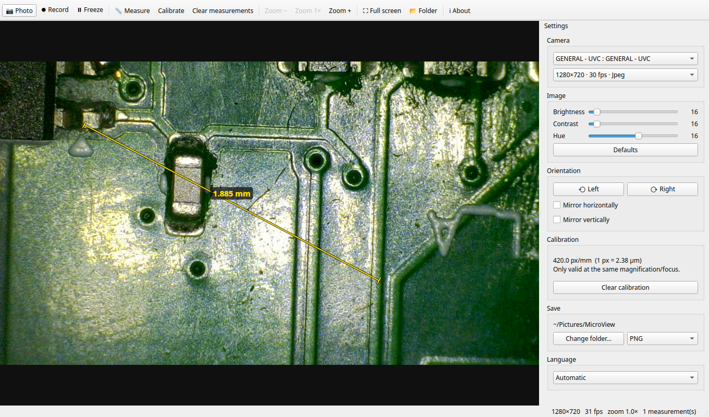

# MicroView

A viewer for USB microscopes on Linux. It works with any microscope that presents itself as a
standard UVC camera, such as the ones that ship with HiView or AMCap for Windows.



- Live view, photos (PNG/JPG) and video recording (H.264 MP4)
- Brightness, contrast and the other controls the camera offers
- Rotate, mirror, freeze, digital zoom and full screen
- Distance measurements in mm or µm after calibrating on a known length
- English and Dutch user interface

## Install

### Ready-made

The [releases page](https://github.com/ptdxl/microview/releases) has:

- **Portable version** (`MicroView-<version>-linux-x86_64`): a single file containing Python, Qt
  and FFmpeg. Nothing to install:

  ```bash
  chmod +x MicroView-*-linux-x86_64
  ./MicroView-*-linux-x86_64
  ```

- **RPM for Fedora**: installs the `microview` command and a menu entry, and pulls in the
  dependencies itself:

  ```bash
  sudo dnf install ./microview-*.noarch.rpm
  ```

### From source

Needs Python 3.9+, PySide6 and FFmpeg (for video recording).

```bash
sudo dnf install python3-pyside6 ffmpeg-free     # Fedora
pip install -r requirements.txt                  # other systems, in a virtual environment
python3 microview.py
```

`./install.sh` adds the app to the application menu for the current user, without root
(`./install.sh --uninstall` removes it again).

### Build it yourself

| What | Command | Result |
|---|---|---|
| Portable version | `packaging/build-portable.sh` | `dist/MicroView-<version>-linux-x86_64` |
| RPM for Fedora | `packaging/build-rpm.sh` | `dist/microview-<version>-*.noarch.rpm` |

The portable script creates a virtual environment in `build/` and fetches PySide6, imageio-ffmpeg
and PyInstaller from PyPI. Pushing a tag that starts with `v` (for example `v1.3`) makes GitHub
Actions build both and attach them to a release; see `.github/workflows/release.yml`.

To check a build without clicking through it, run it with `--selftest`. That opens the window,
encodes a short test video with FFmpeg and, if a camera is connected, grabs a frame. Add
`QT_QPA_PLATFORM=offscreen` on a machine without a display.

## Usage

| Function | Key | Notes |
|---|---|---|
| Photo | Space | PNG or JPG, including drawn measurements |
| Record video | R | H.264 `.mp4` (8-bit 4:2:0); records what you see: rotated, mirrored and with measurements |
| Freeze | P | |
| Measure | M | Drag a line; right-click removes the last one |
| Calibrate | K | Measure a known length first, then enter its real length in mm |
| Clear measurements | Del | |
| Zoom in / out | Mouse wheel, `+` / `-`, or the Zoom buttons | Drag to pan, double-click toggles 1×/2× |
| Zoom 1× | `0` | Resets the digital zoom: the whole image fits the window (only active when zoomed in) |
| Full screen | F11 / Esc | |
| Open output folder | Ctrl+O | `MicroView` in your pictures folder by default |
| About | F1 | Short help, author and link to the source code |

The image controls, orientation, calibration, output folder and language are in the panel on the
right. Below the camera name is the list of resolutions and frame rates the camera offers; the
highest one is selected automatically. A calibration is only valid at the same magnification and
focus.

The language follows the system language. Override it in the panel, or with the environment
variable `MICROVIEW_LANG=en` or `MICROVIEW_LANG=nl`.

## Platform notes

- The camera controls (brightness, contrast, …) talk to V4L2 directly and are Linux-only.
- Windows is not supported yet. The code avoids Linux-only dependencies elsewhere, so a Windows
  build is possible, but it has not been built or tested.

## Files

| File | Purpose |
|---|---|
| `microview.py` | The whole application |
| `microview.svg`, `microview.desktop` | Icon and menu entry |
| `requirements.txt` | Python dependencies |
| `install.sh` | Per-user install from source |
| `packaging/` | Build scripts for the portable version and the RPM package |
| `.github/workflows/release.yml` | Automated releases |

## License

MicroView is free software, released under the [GNU General Public License v3.0 or later](LICENSE).
Copyright © 2026 Ptdxl.

The portable version bundles [Qt for Python (PySide6)](https://doc.qt.io/qtforpython-6/) (LGPL-3.0)
and a GPL build of [FFmpeg](https://ffmpeg.org/), taken from
[imageio-ffmpeg](https://github.com/imageio/imageio-ffmpeg), which runs as a separate program.
